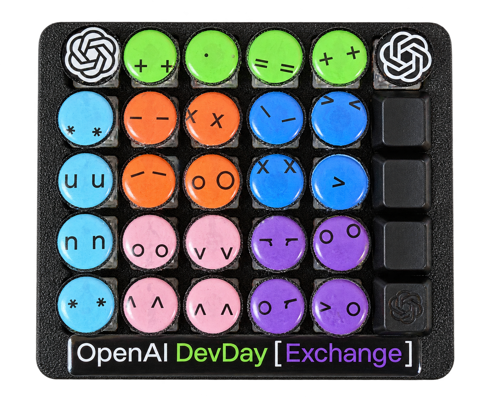
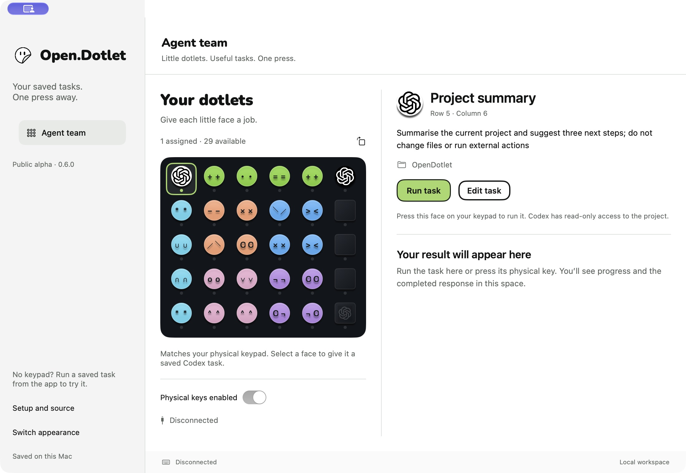
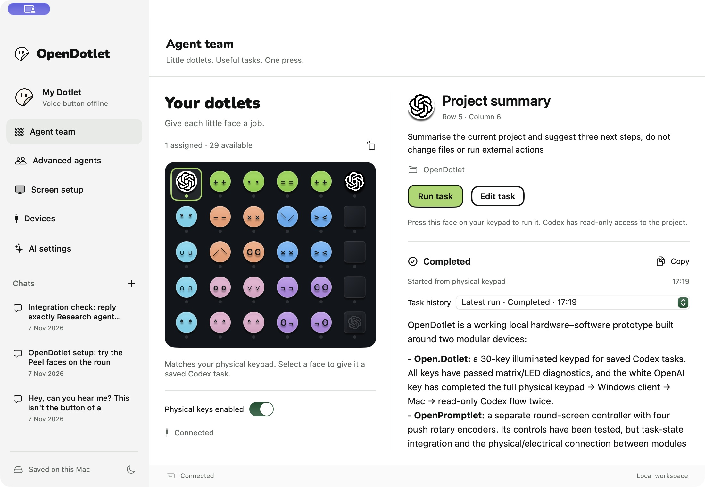
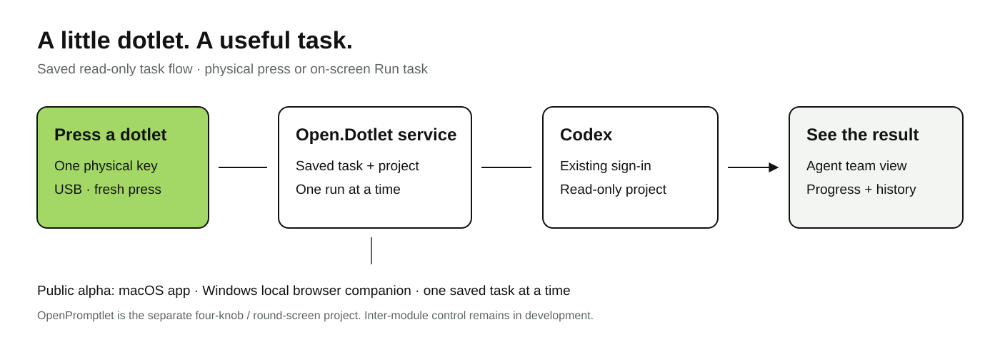

<div align="center">


# Open.Dotlet

**Give your favourite prompts a button.**

A build-your-own, 30-key prompting tablet for saved Codex tasks. Made by [HeySalad](https://github.com/heysalad-ai).

**[Website](https://opendotlet.com) · [Download](https://github.com/heysalad-ai/opendotlet/releases/tag/v0.6.0-alpha.2) · [Product Hunt](https://www.producthunt.com/products/open-dotlet) · [Timeline](docs/TIMELINE.md) · [Roadmap](docs/ROADMAP.md) · [Support](https://buymeacoffee.com/heysalad)**



OpenAI Dev Day Exchange Edition — inspired by event swag and a simple idea: make useful prompts tangible.

<sub>Actual product photo, with AI background removal.</sub>

</div>

## Try it today

Run the first saved task **without a keypad**. Open.Dotlet uses your own Codex CLI installation and sign-in. Python is included in both downloads.

| Platform | Download | Requirements and signing |
| --- | --- | --- |
| macOS | [Mac alpha ZIP](https://github.com/heysalad-ai/opendotlet/releases/download/v0.6.0-alpha.2/OpenDotlet-0.6.0-alpha.2-macOS-AppleSilicon.zip) | Apple Silicon, macOS 14+. Native app, Developer ID signed and Apple notarized. |
| Windows | [Signed Windows alpha ZIP](https://github.com/heysalad-ai/opendotlet/releases/download/v0.6.0-alpha.2/OpenDotlet-0.6.0-alpha.2-Windows-x64-Signed.zip) | Windows 11 x64. Launcher signed as **HeySalad Inc.** with Azure Artifact Signing and a trusted Microsoft timestamp. Local browser companion. |

1. Install the current [Codex CLI](https://learn.chatgpt.com/docs/codex/cli) and sign in.
2. On Mac, unzip and drag `OpenDotlet.app` into Applications. On Windows, extract the **whole** ZIP, open `OpenDotlet/OpenDotlet.exe`, and keep its launcher console open.
3. Select the white-logo dotlet. Edit its project folder if needed, then choose **Run task**.
4. Read progress and the completed response beside your dotlets.

The starter task asks: “Summarise the current project and suggest three next steps; do not change files or run external actions.” One saved read-only task runs at a time. Your Codex account's normal access and usage limits apply; no account, API key or subscription is included.

[Setup and release notes](https://github.com/heysalad-ai/opendotlet/releases/tag/v0.6.0-alpha.2) · [Checksums](https://github.com/heysalad-ai/opendotlet/releases/download/v0.6.0-alpha.2/SHA256SUMS.txt) · [Companion source](https://github.com/heysalad-ai/opendotlet/tree/v0.6.0-alpha.2/companion)

## Your dotlets

Each little face is a task binding: give it a saved prompt and project, then use its on-screen control or physical key. The illustrated map matches the photographed 6×5 keypad.



*The downloadable Mac alpha. Thirty key positions, one starter assignment; the result area is empty until a task runs.*

<details>
<summary>See a completed result from the earlier working prototype</summary>



This is a real development-app screenshot. Its additional voice and advanced-agent navigation is outside the downloadable saved-task alpha.
</details>



## Available now and next

| Available in the public alpha | Planned or needs more validation |
| --- | --- |
| Saved read-only tasks, editable assignments and results/history | General writable workflows and independent concurrent agents |
| Native Mac app and Windows local browser companion | Packaged Chrome extension and supported plugin installation |
| Illustrated 30-key map, starter task, cancel/pause controls | Rich task-status lighting and shareable workflow packs |
| USB connection support; earlier prototype key-to-Codex flow demonstrated | Fresh full USB-to-provider acceptance on the portable Windows release |
| Signed downloads; bundled local Python runtime | Direct API-key keypad execution and clean-machine onboarding |

The keypad prototype's 30 press/release positions were tested on 13 November. The white-logo key ran a real read-only Codex task and showed its result in the Mac development app. The signed Windows download passed clean-state startup, UI and authenticated local-API checks; that is separate from the remaining Windows hardware test.

[Detailed release evidence](docs/RELEASE-STATUS.md) · [Development timeline](docs/TIMELINE.md) · [Roadmap and completion criteria](docs/ROADMAP.md)

## Two projects, one modular idea

**Open.Dotlet** is the keypad and saved-task companion. **[OpenPromptlet](https://github.com/heysalad-ai/openpromptlet)** is the separate four-knob, round-screen controller. Each is intended to be useful alone; attaching them into one device and sharing task state remain development work.

This repository also preserves the earlier ESP32-S3 round-display gallery: [firmware quickstart](docs/QUICKSTART.md), [artwork customization](docs/CUSTOMIZATION.md) and [historical README](docs/legacy/ROUND-DISPLAY-README.md). These are a distinct firmware track, not keypad flashing instructions.

## Timeline and roadmap at a glance

| Milestone | Status |
| --- | --- |
| August 2026 — early physical AI control-deck concept | Historical design brief |
| 6–12 November — round-display groundwork, control experiments and modular direction | Prototype/source milestones |
| 13 November — 30-key test, physical saved-task run and Agent team interface | Demonstrated on the development setup |
| 13 November — public Mac and signed Windows alpha.2 | Released and download-verified |
| 14 November, 08:01 GMT — Product Hunt launch | Scheduled by Product Hunt |
| Next — onboarding, clean-machine and hardware reliability | Planned first milestone |
| Then — mappings, CLI/plugins, Chrome, API-key mode and modular feedback | Proposed phased roadmap |

The [full timeline](docs/TIMELINE.md) explains the decisions and evidence. The [roadmap](docs/ROADMAP.md) gives indicative windows, deliverables, dependencies and acceptance checks; future dates are targets, not shipping promises.

## Source and contributions

The downloadable companion's exact source is under the **alpha.2 release tag**, in `companion/`. The default branch retains the round-gallery source and current project documentation.

```sh
git clone --branch v0.6.0-alpha.2 https://github.com/heysalad-ai/opendotlet.git
cd opendotlet/companion
```

Start with [companion setup](https://github.com/heysalad-ai/opendotlet/blob/v0.6.0-alpha.2/companion/docs/releases/ALPHA-README.md), [contributing](CONTRIBUTING.md), or an [issue](https://github.com/heysalad-ai/opendotlet/issues). Useful contributions include reproducible setup reports, accessible key editing, USB recovery, original icon packs and verified build instructions. Include your OS, app version, board/firmware version and observed result. Keep keys, recordings and private project contents out of reports.

## Community and support

Open.Dotlet is an open-source gift to the OpenAI developer community. We’re excited to see your sticker colour combinations and the ideas you bring to this project.

Our connection to OpenAI comes through participation in its developer community, hackathons and events, where we obtained the swag that inspired Open.Dotlet. This is an independent HeySalad project and has not been endorsed or approved by OpenAI, formally or informally. We will update this notice if we receive official communication from OpenAI about the project.

If you’d like to support the project, [buy HeySalad a coffee](https://buymeacoffee.com/heysalad). Ideas, contributions and feedback are welcome whether or not you donate.

## License and credits

Original application code is [MIT licensed](LICENSE). The Mac shell retains NiceDeck/OpenStreamDeck attribution; bundled runtimes retain their upstream licences. Peel artwork, event artwork and third-party marks have separate rights: see [companion notices](https://github.com/heysalad-ai/opendotlet/blob/v0.6.0-alpha.2/companion/THIRD_PARTY_NOTICES.md) and [gallery notices](THIRD_PARTY_NOTICES.md). ElatoAI helped inspire the earlier gallery documentation structure.

Open.Dotlet is a build-your-own project and public alpha, not an offer to ship finished hardware. It is not an official OpenAI product or an accepted OpenAI Cookbook project.
