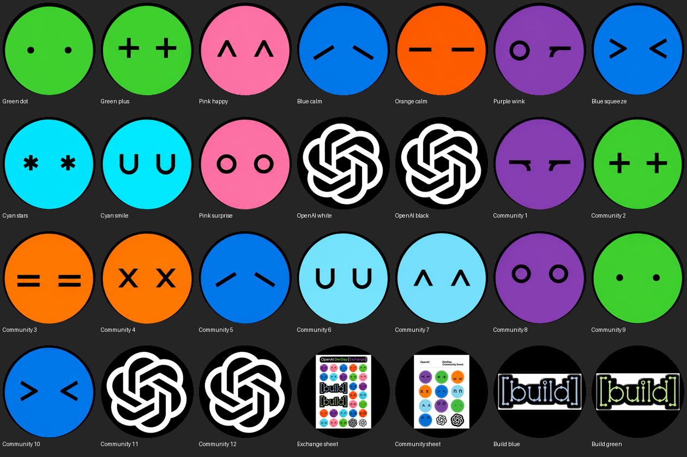
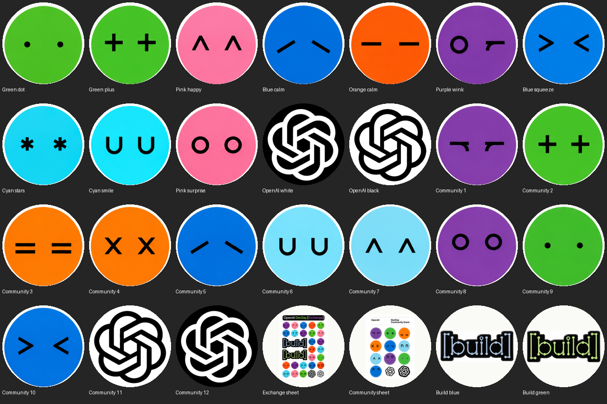

# OpenDotlet

[](https://github.com/heysalad-ai/opendotlet/actions/workflows/build.yml)

A little round display with a lot of personality. Built in public by [HeySalad](https://github.com/heysalad-ai).

OpenDotlet turns a Waveshare ESP32-S3 round touchscreen into a pocket gallery of expressive dots, inspired by OpenAI event stickers. It runs entirely on the board: no account, Wi-Fi configuration or API key needed.



## What works today

- 28 full-screen views: 24 faces/logos, two sticker-sheet references and two Build graphics.
- Black and light gallery themes, selected when building. Black is the default.
- Automatic playback every seven seconds, tap to advance and pause, hold to toggle playback.
- USB serial controls: `NEXT`, `PREV`, `PAUSE`, `AUTO`, `STATUS` at 115200 baud.

This first release is the working gallery. Agent integrations, CI status, sound and a custom enclosure are future experiments; they are not implemented here.

## Hardware

Tested on **Waveshare ESP32-S3-Touch-LCD-1.46**, with a 412 × 412 SPD2010 display/touch controller, 16 MB flash and 8 MB octal PSRAM. A USB data cable is enough for this gallery. Other round boards, including the 1.8-inch AMOLED model, need different drivers and are not supported by this build.

See [Waveshare's board documentation](https://docs.waveshare.com/ESP32-S3-Touch-LCD-1.46) and [hardware notes](docs/HARDWARE.md).

## Build

Install [ESP-IDF v5.3.2](https://docs.espressif.com/projects/esp-idf/en/v5.3.2/esp32s3/get-started/index.html) and activate its environment with the `export.sh` script from your IDF installation. Use Python 3.9 or newer.

```sh
git clone https://github.com/heysalad-ai/opendotlet.git
cd opendotlet
python -m pip install -r requirements.txt
python tools/bootstrap.py
python tools/pack_assets.py --theme black
python tools/validate_assets.py
python -m unittest discover -s tests -v
idf.py set-target esp32s3
idf.py build
```

The bootstrap downloads checksum-pinned Waveshare board support and LVGL 8.3.11. See [dependencies.json](dependencies.json) and [third-party notices](THIRD_PARTY_NOTICES.md). These downloaded directories are ignored by Git. A network connection is needed for setup; the gallery itself is offline.

For the light theme, regenerate assets and rebuild:

```sh
python tools/pack_assets.py --theme light
python tools/validate_assets.py
idf.py build
```



The generated preview is `resources/preview.png`. The two sheet-reference views retain their white paper, even in the black theme. Themes are build-time choices, not an on-device menu.

## Flash and use

Identify your board's serial port (for example `/dev/cu.usbmodem…` on macOS, `/dev/ttyACM0` on Linux, or `COM3` on Windows). Back up any firmware/data you want to keep before replacing it. Flashing writes the bootloader, partition table and gallery app.

```sh
idf.py -p YOUR_PORT flash monitor
```

Exit the monitor with **Ctrl+]**. The first face appears automatically. Tap once to advance and hold on the new face; long-press to toggle the slideshow. Serial `NEXT`/`PREV` move without changing playback mode; `PAUSE` stops playback and `AUTO` resumes it.

An optional serial smoke check resets the board when the port opens, then exercises all views and leaves automatic playback running:

```sh
python tools/verify_serial.py --port YOUR_PORT
```

See [verification evidence and limits](docs/VERIFICATION.md). This is an early hardware prototype, not a production device.

## Make it your own

Replace `artwork/atlas-black.png` or `artwork/atlas-light.png` with a **1536 × 1024** atlas: six columns and four rows of 256-pixel square tiles. Keep artwork centered, with a two-pixel inset at tile edges. The exporter trims that inset and scales each tile to 412 × 412. Tile ordering and display names are in `artwork/names.json`.

The final four views are added from the sheet reconstructions in `artwork/`. Edit `tools/pack_assets.py` to replace those views. Frame count and size must stay consistent with the generated LVGL descriptors and available flash.

The data format is big-endian RGB565 with `CONFIG_LV_COLOR_16_SWAP=y`. Generated assets are intentionally not committed; regenerate them with the exporter.

## Contribute

See [CONTRIBUTING.md](CONTRIBUTING.md). Small, tested improvements are welcome: better documentation, custom artwork support, accessibility, power measurement and additional board ports. Start a discussion in an issue before changing the hardware abstraction or adding network services.

## License and artwork

HeySalad's original code is **MIT licensed**. Downloaded vendor code keeps its own notices and terms; see [THIRD_PARTY_NOTICES.md](THIRD_PARTY_NOTICES.md).

The included event-inspired artwork is a digital reconstruction, not official OpenAI source artwork. Artwork and trademarks are excluded from the MIT code license. OpenAI names and logos belong to their respective owner; this independent HeySalad project is not affiliated with or endorsed by OpenAI. See [artwork/README.md](artwork/README.md).
