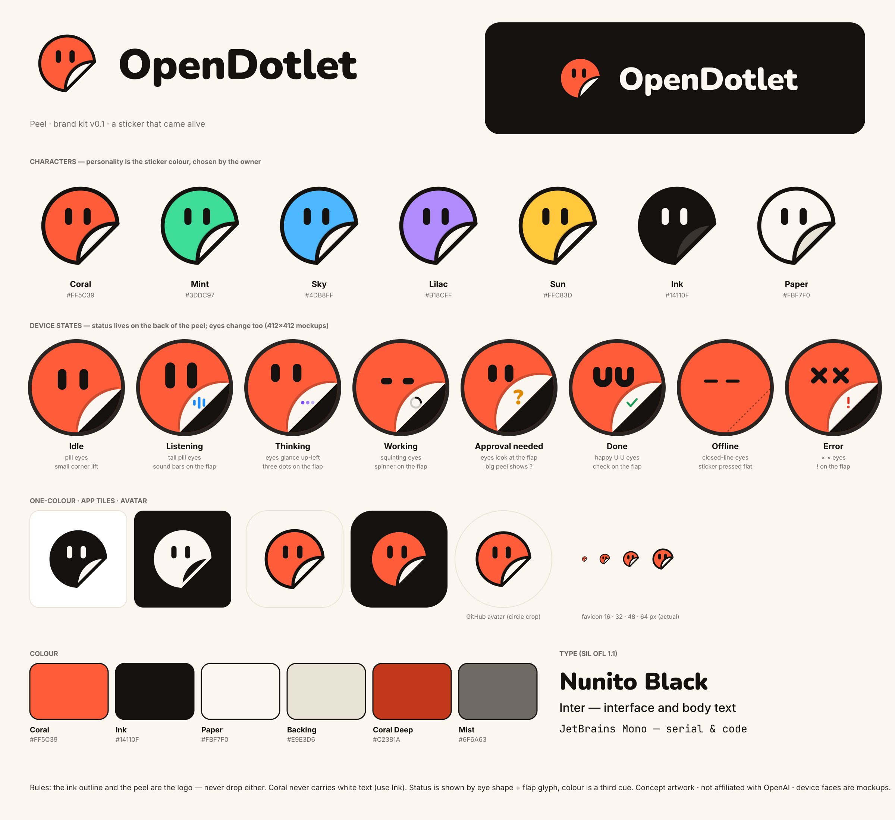
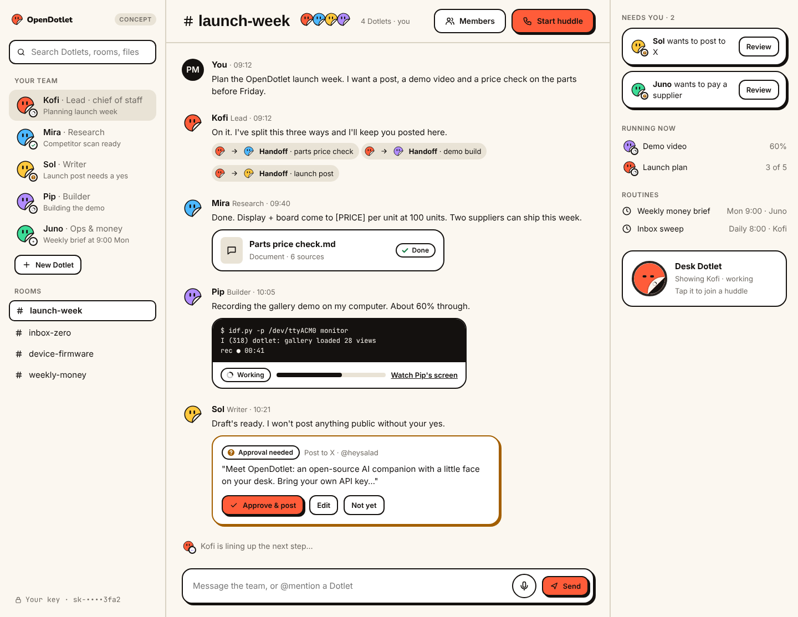
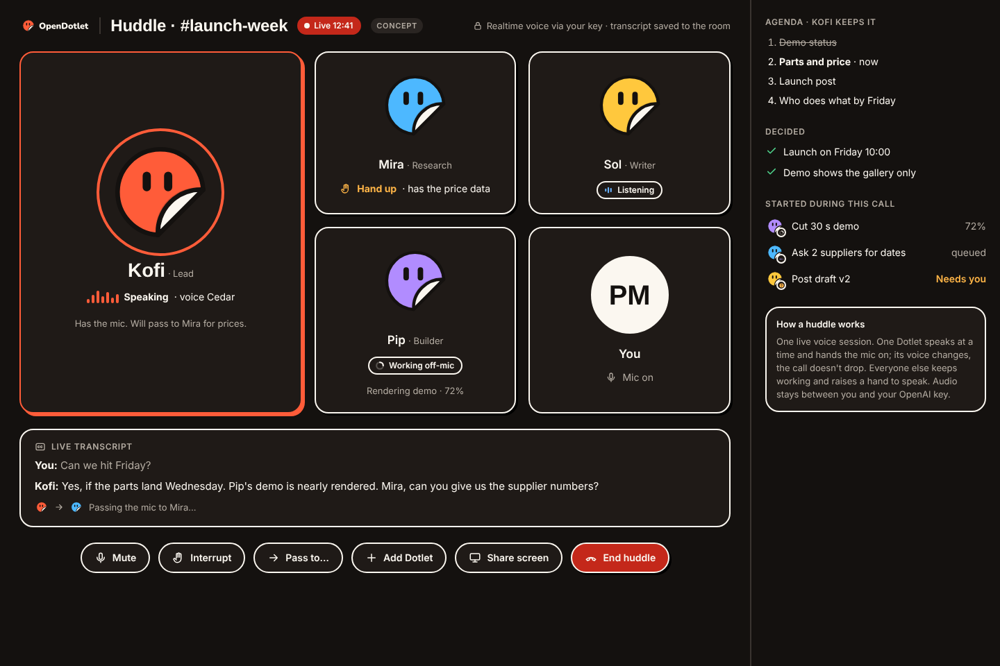
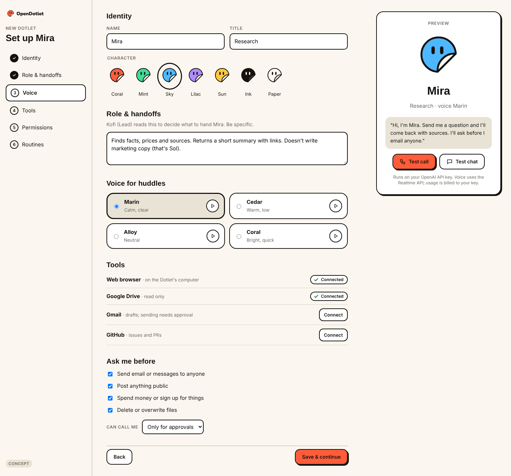
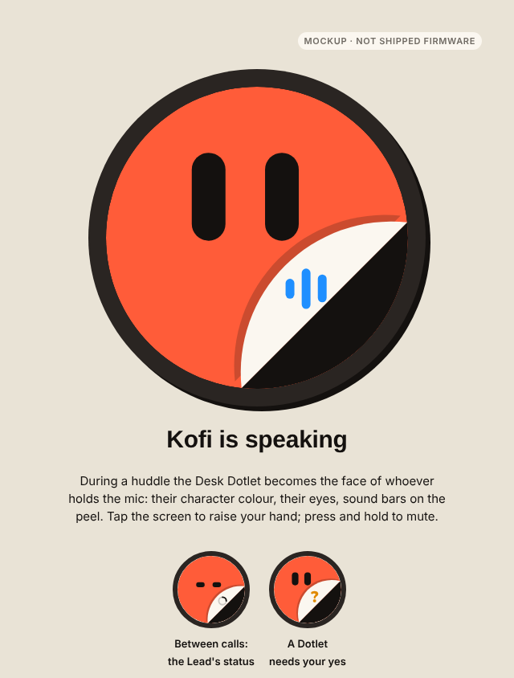
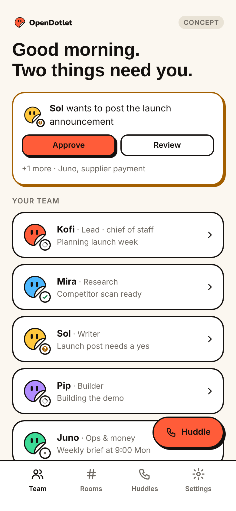
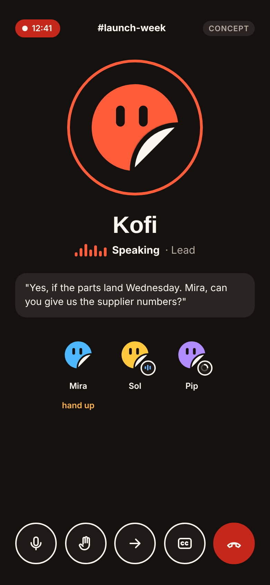
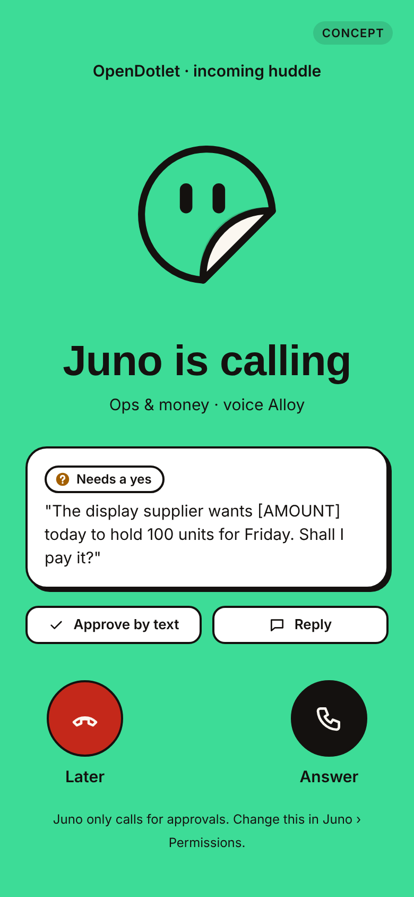
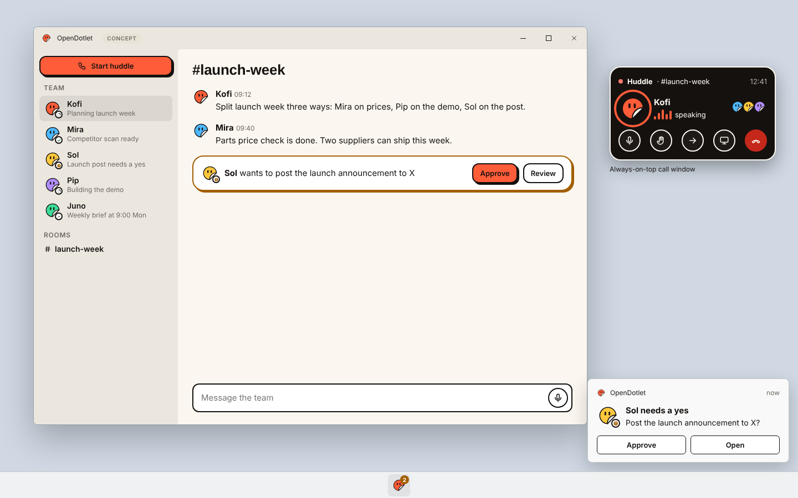
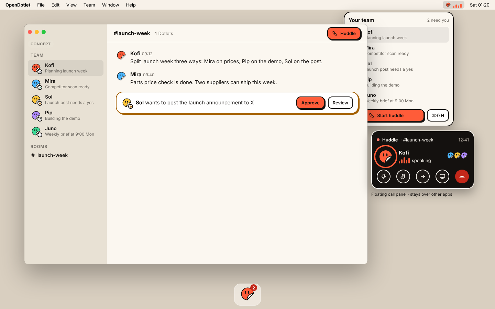

# OpenDotlet design

Brand identity and UI concepts for OpenDotlet. **Everything in this folder is a design concept.** None of it changes the firmware, and the multi-agent, voice and app features shown here are planned, not built. The shipped product is still the offline ESP32 touch gallery described in the [root README](../README.md).

## Brand: Peel

A sticker that peeled itself off the sheet and came alive: a coral sticker with an ink outline, pill eyes and a lifted corner. On the device, the eyes show the expression and the back of the peel shows the status.

- [`brand/BRAND-GUIDE.md`](brand/BRAND-GUIDE.md): principles, voice, logo rules, characters, device states, colour, type and accessibility.
- `brand/logo/`: symbol (colour, on-dark, black, white), favicon (for 16–48 px), GitHub avatar, app tiles, lockups and wordmark. SVG, plus PNG from 16 to 1024 px.
- `brand/characters/`: the seven character colours (Coral, Mint, Sky, Lilac, Sun, Ink, Paper).
- `brand/device/`: the eight 412×412 state faces (idle, listening, thinking, working, approval needed, done, offline, error) and an idle boot face per character. Mockups only.
- `brand/tokens/`: `tokens.json` (colours for light and dark, type, spacing, radius, shadows) and `components.css` (button, chip, card, toast and log styles, with the `od-` prefix).

Fonts: Nunito, Inter and JetBrains Mono, all under the SIL Open Font License 1.1, loaded from Google Fonts. Upstream: [googlefonts/nunito](https://github.com/googlefonts/nunito), [rsms/inter](https://github.com/rsms/inter), [JetBrains/JetBrainsMono](https://github.com/JetBrains/JetBrainsMono).

## UI concepts: OpenDotlet Teams

A team of persistent Dotlets (name, character, role, memory, tools), coordinated by a Lead and running on the owner's own OpenAI API key. A **huddle** is a voice call with your team: one live voice session in which a single Dotlet speaks at a time and hands the mic on, while the others keep working and raise a hand to speak. Nothing public or costly happens without an approval card.

Open any file in `teams-ui/html/` in a browser; the PNGs in `teams-ui/png/` are renders of the same files.

| Web: team home | Web: huddle |
|---|---|
|  |  |
| **Web: set up a Dotlet** | **Desk Dotlet in a huddle** |
|  |  |

| Mobile: team | Mobile: huddle | Mobile: a Dotlet calls you |
|---|---|---|
|  |  |  |

| Windows 11 | macOS |
|---|---|
|  |  |

The live, editable versions of these screens are on a private Claude design canvas; this folder is a snapshot of it. Team names (Kofi, Mira, Sol, Pip, Juno), prices and messages are placeholders.

## Exploration

`exploration/` holds the first-round comparison of four directions (A Dot + Dotlet, B Peel, C Puck, D Open Ring) and the round-one recommendation. B (Peel) was chosen.

## Source

`source/` contains the Python scripts that drew the brand assets and the UI screens. They're kept for reference: their paths point at the original working folders, so you'll need to adjust them before running.

## Licensing and provenance

All artwork in this folder is original work made for HeySalad in November 2026, © 2026 HeySalad. The licence for the artwork hasn't been chosen yet, so it isn't covered by the root MIT licence until a decision is recorded here. The OpenAI event stickers were used only as mood reference: no OpenAI logo, knot or sticker artwork appears here. No trademark clearance search has been done. OpenDotlet is not affiliated with, sponsored by or endorsed by OpenAI, and the Teams concept doesn't use any xAI or Grok branding.
