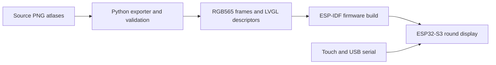
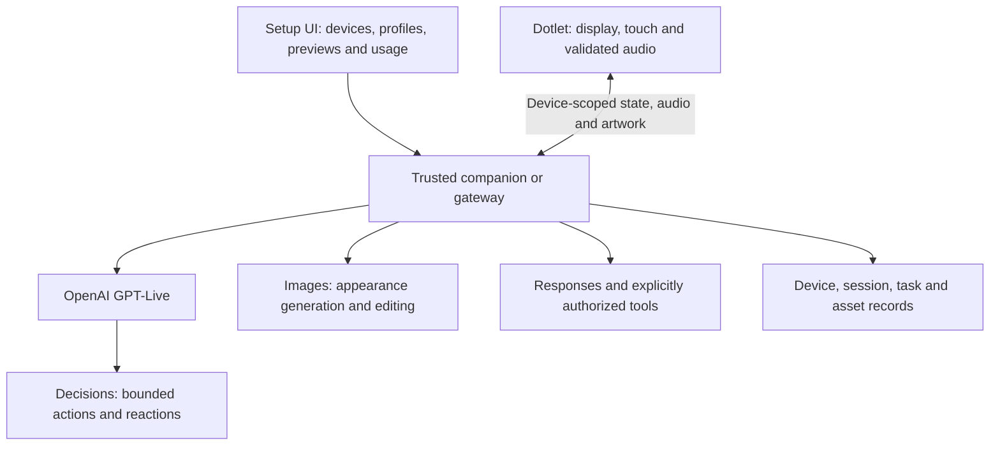

# OpenDotlet architecture

## Running today: offline gallery

The exporter prepares 28 full-screen 412 × 412 frames. ESP-IDF embeds them in the application. LVGL renders the selected frame and the matching Waveshare drivers handle display, touch and power control. The board needs no network or API credential for this mode.

## Planned: physical OpenAI agent interface

The following components are a design plan, not existing applications in this repository:

The three required integration tracks are **live voice, Decisions and Images**. The companion owns the long-lived OpenAI project credential, pairing, authorization and session routing. A Dotlet receives its own scoped identity. Physical devices, logical agent profiles, conversations and background tasks remain separate objects.

The first proposed end-to-end interaction is a spoken appearance request, a bounded decision, generated artwork, a reviewed/exported asset and a confirmed physical display. Ordinary reactions use cached assets. Model-selected expression is distinct from observed microphone/playback/network state.

No backend framework, hosting vendor or database has been selected for implementation here. A local companion is the proposed first path. A multi-user hosted service would require separate design and testing.

## Cookbook direction

The proposed contribution is a focused, reproducible guide/reference implementation built around current OpenAI APIs, physical behavior and measurements. OpenDotlet has not been accepted into the Cookbook. [ElatoAI's accepted ESP32 guide](https://github.com/openai/openai-cookbook/pull/1808) is prior art; its broader application remains independently maintained.

See the [roadmap](ROADMAP.md) for milestones and the [current contribution process](https://github.com/openai/openai-cookbook/blob/main/CONTRIBUTING.md) before preparing a submission.
