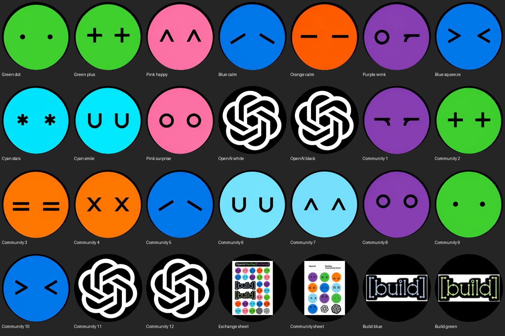
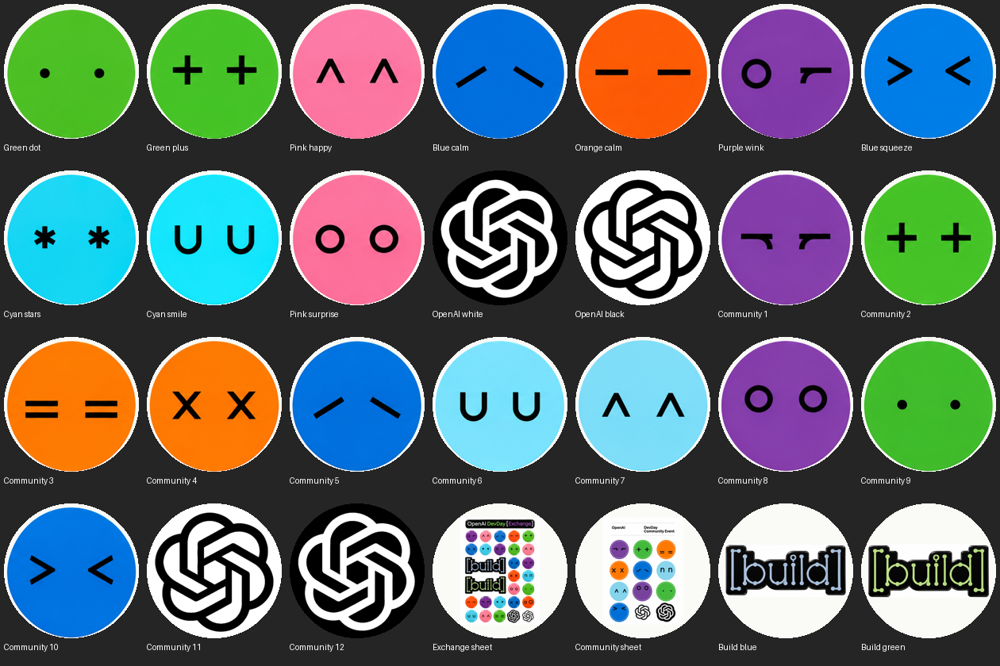
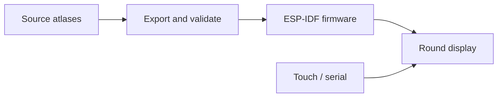
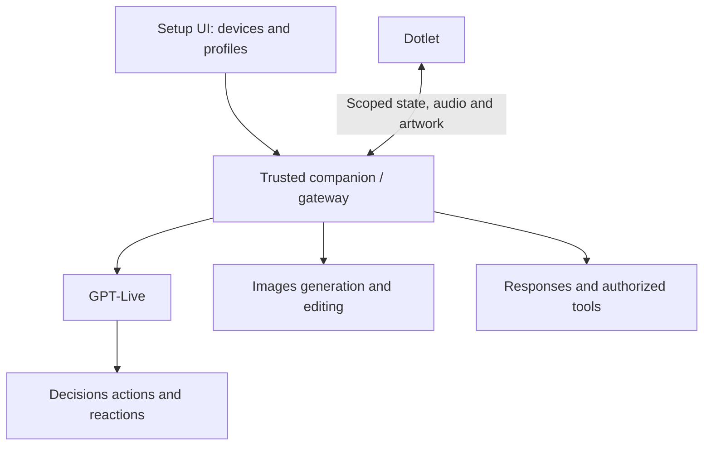

> Historical round-display project documentation, preserved from 300ba21. See the [current project README](../../README.md) for the keypad and downloadable companion.

<div align="center">

# OpenDotlet

**A little round display with a lot of personality.**

Expressive hardware for OpenAI-powered agents, built in public by [HeySalad](https://github.com/heysalad-ai).

[](https://github.com/heysalad-ai/opendotlet/actions/workflows/build.yml) [](https://github.com/heysalad-ai/opendotlet/blob/300ba21c896d1a7ff5131df4db89ba9ad57d2942/LICENSE) [](https://github.com/heysalad-ai/opendotlet/blob/300ba21c896d1a7ff5131df4db89ba9ad57d2942/docs/HARDWARE.md)

**[Quickstart](https://github.com/heysalad-ai/opendotlet/blob/300ba21c896d1a7ff5131df4db89ba9ad57d2942/docs/QUICKSTART.md) · [Gallery](#gallery-preview) · [Hardware](#hardware) · [Architecture](#project-architecture) · [Roadmap](https://github.com/heysalad-ai/opendotlet/blob/300ba21c896d1a7ff5131df4db89ba9ad57d2942/docs/ROADMAP.md) · [Contribute](https://github.com/heysalad-ai/opendotlet/blob/300ba21c896d1a7ff5131df4db89ba9ad57d2942/CONTRIBUTING.md)**

**Running today: the offline touch gallery.** Live voice, Decisions, image generation and a multi-device UI are planned integrations.

<a href="https://github.com/heysalad-ai/opendotlet/blob/300ba21c896d1a7ff5131df4db89ba9ad57d2942/docs/preview-black.png"></a>


</div>

## News

- **6 November 2026:** OpenDotlet is public under HeySalad, with working firmware, pinned dependencies and GitHub build checks.
- **6 November 2026:** Both individual cyan/blue smile faces now have upright **U U** eyes. Seven asset tests include orientation and unchanged-frame checks.
- **Next milestone:** a small OpenAI-powered companion connecting **GPT-Live + Decisions + Images** to the physical display. See the [implementation roadmap](https://github.com/heysalad-ai/opendotlet/blob/300ba21c896d1a7ff5131df4db89ba9ad57d2942/docs/ROADMAP.md).

## What is OpenDotlet?

OpenDotlet turns a **Waveshare ESP32-S3-Touch-LCD-1.46** into a pocket gallery of expressive dots. The current release runs entirely on the board: no account, Wi-Fi configuration or API key needed. Tap to advance; hold to toggle the slideshow.

The product direction is a physical interface for agents: talk to a Dotlet, see useful reactions and task status, personalize its appearance, and assign profiles to multiple devices. Those capabilities will be added in verified stages.

- [Build and flash your first Dotlet](https://github.com/heysalad-ai/opendotlet/blob/300ba21c896d1a7ff5131df4db89ba9ad57d2942/docs/QUICKSTART.md)
- [Make your own face pack](https://github.com/heysalad-ai/opendotlet/blob/300ba21c896d1a7ff5131df4db89ba9ad57d2942/docs/CUSTOMIZATION.md)
- [Understand the running firmware and proposed platform](https://github.com/heysalad-ai/opendotlet/blob/300ba21c896d1a7ff5131df4db89ba9ad57d2942/docs/ARCHITECTURE.md)
- [Follow the roadmap](https://github.com/heysalad-ai/opendotlet/blob/300ba21c896d1a7ff5131df4db89ba9ad57d2942/docs/ROADMAP.md)

## Gallery preview

The image above shows the actual exported artwork used by the firmware. It is a contact sheet, not a recording of a physical board. The gallery has been flashed and exercised on the supported board; see [verification](https://github.com/heysalad-ai/opendotlet/blob/300ba21c896d1a7ff5131df4db89ba9ad57d2942/docs/VERIFICATION.md) and the [U-eye correction](https://github.com/heysalad-ai/opendotlet/blob/300ba21c896d1a7ff5131df4db89ba9ad57d2942/docs/U-EYES-FIX.md).

There are **28 full-screen views**: 24 individual faces/logos, two reference sheets and two Build graphics. Choose black or light backgrounds when building.

<details>
<summary><strong>View the light theme</strong></summary>
<br>


The sheet-reference views retain white paper. Themes are build-time choices; runtime switching is planned separately.
</details>

A real-device video is still to be recorded. The intended demo will show the physical board, touch controls and normal playback. Future voice demonstrations will include audible, captioned footage and identify where the microphone and speaker run.

## OpenAI integrations

These are the **required next integration tracks**, not features already running in this release:

| Integration | Role in OpenDotlet | Status |
| --- | --- | --- |
| [GPT-Live](https://developers.openai.com/api/docs/guides/live) | Spoken conversation while backend work runs | Planned |
| [Decisions API](https://developers.openai.com/api/docs/guides/decisions-voice) | Bounded actions and expressive reactions from live conversation events | Planned |
| [Images](https://developers.openai.com/api/docs/guides/image-generation) | Personalized faces/scenes with preview and verified installation | Planned |
| Responses and function calling | Useful tools and confirmed device actions | Planned |
| Agents, retrieval and optional MCP/plugins | Responsibilities, knowledge and connected tools | Later modules |

The first proposed workflow is a spoken appearance request → bounded decision → generated artwork → reviewed/exported asset → confirmed physical display. Ordinary reactions use cached artwork.

Future API mode will use a dedicated OpenAI project credential on the trusted companion/server. Devices receive separate scoped identities. A project key does not grant access to private GitHub, Gmail or a person's existing ChatGPT dot; those connections require their own authorization.

## Hardware

| Part | Current supported configuration |
| --- | --- |
| Board | Waveshare ESP32-S3-Touch-LCD-1.46 |
| Display and touch | SPD2010, 412 × 412 round LCD |
| Flash / PSRAM | 16 MB / 8 MB octal |
| Power and programming | USB data cable |
| Framework | ESP-IDF 5.3.2 + LVGL 8.3.11 |
| Gallery artwork | Full-screen RGB565, black/light themes |

The onboard microphone, speaker and battery functionality have **not** been validated by this gallery. Similar-looking boards, including the 1.8-inch AMOLED model, need separate drivers/ports.

[Hardware and pin notes](https://github.com/heysalad-ai/opendotlet/blob/300ba21c896d1a7ff5131df4db89ba9ad57d2942/docs/HARDWARE.md) · [Vendor documentation](https://docs.waveshare.com/ESP32-S3-Touch-LCD-1.46)

## Feature list

| Feature | Working now | Planned work |
| --- | --- | --- |
| Full-screen expressions | 28 exported views | Original white/black/color face families |
| Touch controls | Tap next/pause; hold auto/pause | Context-aware controls |
| Playback | Automatic seven-second cadence | Event-driven expressions |
| Serial interface | `NEXT`, `PREV`, `PAUSE`, `AUTO`, `STATUS` | Bounded companion protocol |
| Custom artwork | Source atlases and deterministic export | Generated-asset staging and activation |
| Verification | Asset tests, firmware CI and recorded board checks | Voice, recovery, latency and two-device tests |
| Voice and tool use | — | GPT-Live, Decisions and useful functions |
| Device management | — | Pairing, profiles, revocation and explicit session ownership |
| Images API | — | Generate/edit → preview → export → install |

## Project architecture

**Running gallery**



**Planned agent platform**



The gateway and setup UI are not implemented yet. No hosting vendor, web framework or database is required by the current gallery. See the [architecture guide](https://github.com/heysalad-ai/opendotlet/blob/300ba21c896d1a7ff5131df4db89ba9ad57d2942/docs/ARCHITECTURE.md) for component and credential boundaries.

## Tech stack

| Layer | Today | Next stage |
| --- | --- | --- |
| Firmware | C, ESP-IDF 5.3.2 | Device protocol and measured audio |
| Display | LVGL 8.3.11, Waveshare SPD2010 support | Event-driven state and asset activation |
| Assets | Python, Pillow, RGB565 | Validated generated-art pipeline |
| Verification | Python unittest, GitHub Actions, serial smoke tool | Session replay, failure and latency checks |
| Companion / UI | Not implemented | Local gateway first; framework selection pending |
| OpenAI | Not needed by gallery | Live, Decisions, Images and selected tools |

## Project structure

```text
opendotlet/
├── main/                 # Gallery application and generated descriptors
├── artwork/              # Source atlases, reference sheets and provenance
├── tools/                # Bootstrap, export, validation and serial checks
├── tests/                # Artwork regression and failure-path checks
├── docs/                 # Setup, hardware, architecture and roadmap
├── .github/workflows/    # Firmware build checks
├── dependencies.json     # Pinned upstream sources and checksums
└── sdkconfig.defaults    # Supported ESP32-S3 configuration
```

Generated assets, downloaded board support, build output and private backups are excluded from Git. Upstream components retain their own notices.

## Quickstart

Activate ESP-IDF 5.3.2, then:

```sh
git clone https://github.com/heysalad-ai/opendotlet.git
cd opendotlet
python -m pip install -r requirements.txt
python tools/bootstrap.py
python tools/pack_assets.py --theme black
python tools/validate_assets.py
python -m unittest discover -s tests -v
idf.py set-target esp32s3
idf.py build
```

Identify your board's serial port and back up any firmware/data you want to retain before flashing:

```sh
idf.py -p YOUR_PORT flash monitor
```

[Full setup, controls and troubleshooting](https://github.com/heysalad-ai/opendotlet/blob/300ba21c896d1a7ff5131df4db89ba9ad57d2942/docs/QUICKSTART.md) · [Customize artwork](https://github.com/heysalad-ai/opendotlet/blob/300ba21c896d1a7ff5131df4db89ba9ad57d2942/docs/CUSTOMIZATION.md)

## Verification and limitations

- The exact Waveshare 1.46-inch board is the tested target. Other board variants are unverified.
- CI builds firmware and validates assets; it cannot prove physical touch, appearance or audio quality.
- Themes and artwork are compiled into firmware. Dynamic downloads, OTA updates, Wi-Fi setup and remote controls are not implemented.
- Voice, Decisions, Images API, profile management and persistent agents remain planned. No voice latency or battery-runtime result is claimed.
- The source artwork is a reconstruction, not an official asset pack.

[Initial evidence](https://github.com/heysalad-ai/opendotlet/blob/300ba21c896d1a7ff5131df4db89ba9ad57d2942/docs/VERIFICATION.md) · [Latest artwork checks](https://github.com/heysalad-ai/opendotlet/blob/300ba21c896d1a7ff5131df4db89ba9ad57d2942/docs/U-EYES-FIX.md) · [Security](https://github.com/heysalad-ai/opendotlet/blob/300ba21c896d1a7ff5131df4db89ba9ad57d2942/SECURITY.md)

## Contributing

Start with documentation, original artwork, supported-board fixes or a focused roadmap milestone. Describe the board and checks you ran. Keep model/API access, secrets, hardware behavior and production readiness explicit.

[Contribution guide](https://github.com/heysalad-ai/opendotlet/blob/300ba21c896d1a7ff5131df4db89ba9ad57d2942/CONTRIBUTING.md) · [Open an issue](https://github.com/heysalad-ai/opendotlet/issues) · [Roadmap](https://github.com/heysalad-ai/opendotlet/blob/300ba21c896d1a7ff5131df4db89ba9ad57d2942/docs/ROADMAP.md)

## Acknowledgments and license

[ElatoAI](https://github.com/akdeb/ElatoAI) inspired this product-first repository structure and is an important ESP32 voice-project reference. OpenDotlet's artwork, firmware and proposed OpenAI-only integration plan are documented here independently. OpenDotlet has not been accepted into the OpenAI Cookbook.

HeySalad's original application code is **MIT licensed**. Downloaded vendor support, included artwork and third-party trademarks have separate terms. This independent HeySalad project is not affiliated with or endorsed by OpenAI.

[Code license](https://github.com/heysalad-ai/opendotlet/blob/300ba21c896d1a7ff5131df4db89ba9ad57d2942/LICENSE) · [Artwork terms](https://github.com/heysalad-ai/opendotlet/blob/300ba21c896d1a7ff5131df4db89ba9ad57d2942/artwork/README.md) · [Third-party notices](https://github.com/heysalad-ai/opendotlet/blob/300ba21c896d1a7ff5131df4db89ba9ad57d2942/THIRD_PARTY_NOTICES.md)
